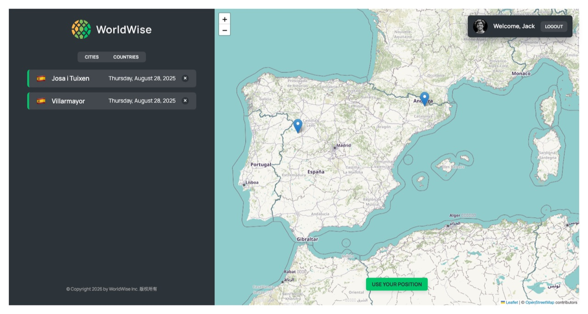
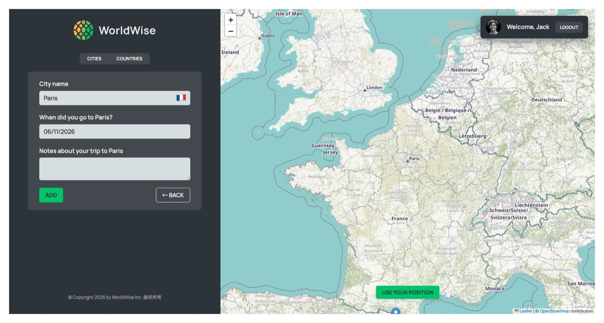
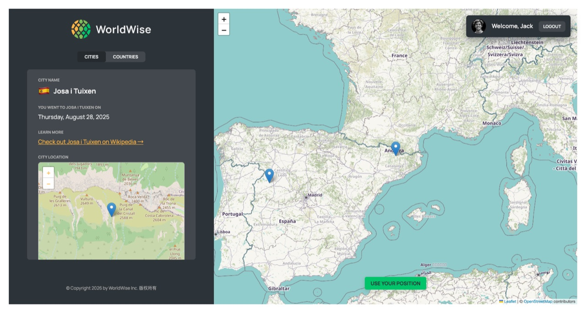
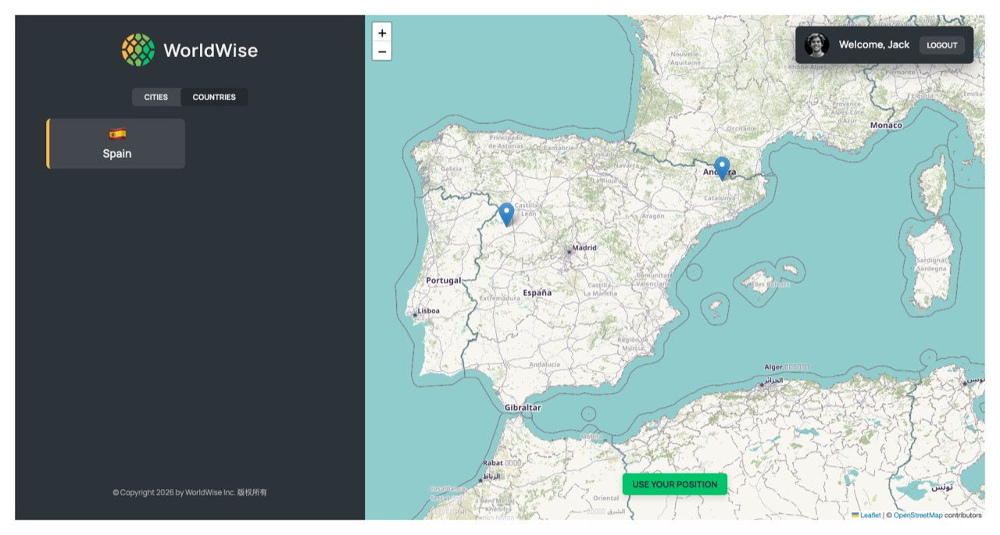
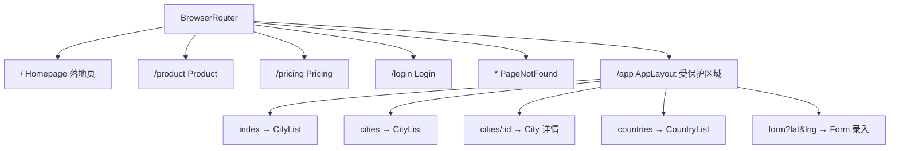
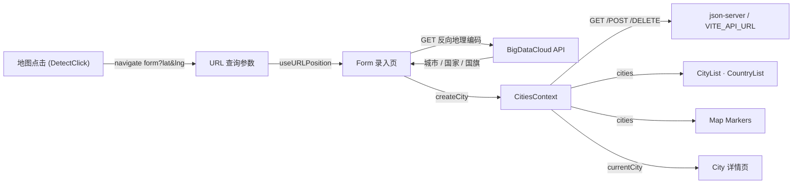

# 🌍 WorldWise · 旅行足迹地图

> 在地图上点亮你去过的每一座城市 —— 基于 React 18 + Vite 的单页应用，把旅行记忆变成一张可交互的世界地图。

[](https://react.dev/)
[](https://vitejs.dev/)
[](https://reactrouter.com/)
[](https://leafletjs.com/)

**WorldWise** 是一个「旅行足迹记录」Web 应用：用户在地图上点击任意坐标，应用自动完成反向地理编码、识别国家并生成国旗 emoji，补全城市名与到访日期后存入行程库；所有城市以地图标记（Marker）和列表两种方式呈现，并支持按国家聚合统计、单城详情回看与删除。

它同时是一个完整的 **React 生态实战样板**：嵌套路由 + 路由级懒加载、Context 状态管理、自定义 Hooks、Leaflet 地图集成、REST 数据层与模拟后端，全部收在一个约 1,600 行源码的小型工程里闭环。

---

## 界面预览

<p align="center">
  
  
  <br />
  
  
</p>

---

## 目录

- [功能特性](#功能特性)
- [技术栈与选型理由](#技术栈与选型理由)
- [系统架构](#系统架构)
- [核心设计](#核心设计)
- [项目结构](#项目结构)
- [本地运行](#本地运行)
- [部署](#部署)
- [工程规范与改进](#工程规范与改进)
- [已知限制与迭代计划](#已知限制与迭代计划)
- [License](#license)

---

## 功能特性

### 核心能力

| 模块 | 说明 |
| --- | --- |
| 🗺️ **地图探索** | 基于 Leaflet + OpenStreetMap 瓦片渲染世界地图，支持缩放、滚轮、城市 Marker 与气泡弹窗 |
| 📍 **点选录入** | 在地图任意位置单击 → 跳转到录入页并携带坐标（URL 查询参数），无需手动填写经纬度 |
| 🔎 **反向地理编码** | 调用 BigDataCloud 免费接口由坐标反查城市名与国家名，并**通过 Unicode 区域指示符算法自动生成国旗 emoji**，零依赖 |
| 🧭 **浏览器定位** | 一键获取当前经纬度并让地图平滑居中（`navigator.geolocation` 封装为自定义 Hook） |
| 🏙️ **足迹管理** | 新增 / 查看 / 删除城市，数据通过 REST 接口持久化到模拟后端 |
| 🌐 **按国家聚合** | `reduce` 归并城市列表，生成「去过的国家」视图，避免重复国家条目 |
| 📄 **城市详情** | 展示城市名、国旗、到访日期（`Intl.DateTimeFormat` 格式化）、旅行笔记、维基百科外链与内嵌小地图 |
| 🔐 **登录与路由守卫** | `useReducer` 管理认证状态，未登录访问 `/app/*` 自动重定向至登录页 |

### 工程能力

- ⚡ **路由级代码分割**：所有页面经 `React.lazy` + `Suspense` 按需加载，首屏只加载必要 chunk
- 📦 **第三方依赖分包**：`vite.config.js` 中通过 `manualChunks` 将 React / Leaflet / datepicker 拆为独立 vendor chunk，主包从 512 kB 降至 12 kB
- 🧩 **嵌套路由 + 布局复用**：`AppLayout` 作为外壳（侧边栏 / 地图 / 用户区），子路由通过 `<Outlet />` 渲染
- 🎨 **CSS Modules 样式隔离**：20 个 `.module.css` 按组件粒度切分，配合全局 CSS 变量统一主题
- 🧠 **状态分层设计**：URL 参数、Context、组件局部状态各司其职，不引入任何额外状态管理库
- 🧪 **开发期质量门禁**：Vite 集成 ESLint 插件，开发时即时报错；`npm run lint` 零警告为合并标准
- ⚙️ **环境变量化 API 地址**：后端地址走 `VITE_API_URL`，同一份代码可在本地与线上运行

---

## 技术栈与选型理由

| 分类 | 选型 | 选型理由 |
| --- | --- | --- |
| 视图框架 | **React 18.2** | 函数组件 + Hooks；`StrictMode` 下提前暴露副作用问题 |
| 构建工具 | **Vite 4.5** | 冷启动与 HMR 远快于 Webpack；原生 ESM 开发体验 |
| 路由 | **react-router-dom 6.30** | 嵌套路由 + `Outlet` + `useSearchParams` 天然承载「地图坐标即 URL 状态」的设计 |
| 地图 | **Leaflet 1.9 + react-leaflet 4.2** | 体积小、社区成熟的栅格地图方案；`useMap` / `useMapEvents` 把命令式 API 包成组件 |
| 状态管理 | **Context API + useReducer** | 数据规模小、跨层级共享明确，引入 Redux/Zustand 属于过度设计 |
| 样式 | **CSS Modules + 全局 CSS 变量** | 零运行时开销、天然作用域隔离 |
| 日期选择 | **react-datepicker 8.10** | 轻量、可主题化，满足「到访日期」单一场景 |
| 模拟后端 | **json-server 0.17** | 以 `data/cities.json` 为数据源自动生成 REST 接口，`--delay 500` 模拟真实网络延迟，便于验证 Loading 态 |
| 代码规范 | **ESLint 8 + react-hooks 插件** | 捕获 Hooks 依赖数组错误与 HMR 不兼容导出 |
| 外部接口 | **BigDataCloud Reverse Geocode** | 免费、无需 API Key，返回 `city` / `locality` / `countryName` / `countryCode` |

---

## 系统架构

### 路由结构



> `/app` 下的路由由 `AppLayout` 统一提供「侧边栏 + 地图 + 用户区」骨架，子页面只替换中间内容区；整个子树由 `ProtectRoute` 在路由表层面统一守卫。

### 数据流



---

## 核心设计

### 1. 用 URL 承载「地图状态」，让视图可分享

地图中心点与录入坐标都放在查询参数里（`/app/form?lat=…&lng=…`），而不是塞进组件 state。带来的直接收益：链接可分享、刷新不丢状态、浏览器前进/后退天然可用。

```js
// src/hooks/useURLPosition.jsx
export function useURLPosition() {
  const [searchParams] = useSearchParams();
  return [searchParams.get('lat'), searchParams.get('lng')];
}
```

### 2. 零依赖生成国旗 emoji

拿到国家代码（如 `ES`）后，把它映射到 Unicode 的「区域指示符符号」，两个字母拼起来就是国旗：

```js
// src/components/Form.jsx
export function convertToEmoji(countryCode) {
  const codePoints = countryCode
    .toUpperCase()
    .split('')
    .map((char) => 127397 + char.charCodeAt()); // 127397 = '🇦' - 'A'
  return String.fromCodePoint(...codePoints);
}
```

比维护「国家 → emoji」映射表更简洁，且天然支持全部 ISO 3166-1 国家代码。

### 3. 把 Leaflet 的命令式 API 封装成声明式组件

Leaflet 是纯命令式的（`map.setView()`、`map.on('click')`），直接与 React 混用容易冲突。项目用两个小组件把副作用收敛起来：

```jsx
// 响应式地移动地图中心
function ChangeCenter({ position }) {
  const map = useMap();
  map.setView(position);
  return null;
}

// 监听地图点击并跳转到录入页
function DetectClick() {
  const navigate = useNavigate();
  useMapEvents({
    click: (e) => navigate(`form?lat=${e.latlng.lat}&lng=${e.latlng.lng}`),
  });
  return null;
}
```

### 4. 认证状态用 `useReducer`，守卫用声明式包装

认证是「动作少、状态迁移明确」的典型场景，`useReducer` 比一堆 `useState` 更清晰：

```jsx
function reducer(state, action) {
  switch (action.type) {
    case 'login':  return { ...state, user: action.payload, isAuthenticated: true };
    case 'logout': return { ...state, user: null, isAuthenticated: false };
  }
}
```

`ProtectRoute` 把「未登录跳转」封装成可复用的包装组件，路由表里一行完成鉴权。

### 5. Context 作为轻量 Store，统一收口异步数据

`CitiesProvider` 同时暴露数据（`cities` / `currentCity`）与动作（`getCity` / `createCity` / `deleteCity`），并统一管理 `isLoading`，避免每个页面各写一套 `fetch` + loading 逻辑。增删操作用不可变更新：

```js
setCities((cities) => cities.filter((city) => city.id !== id)); // 删除
setCities((cities) => [...cities, data]);                       // 新增
```

### 6. 自定义 Hook 隔离浏览器 API

`useGeolocation` 把 `navigator.geolocation.getCurrentPosition` 的回调风格转换成 `{ isLoading, position, error, getPosition }` 状态机，组件只关心 UI，不关心兼容性与错误处理。

---

## 项目结构

```text
worldwise/
├── data/
│   └── cities.json            # json-server 数据源（预置 2 条城市记录）
├── docs/screenshots/          # README 用界面截图
├── public/                    # 静态资源：bg.jpg / logo / 配图
├── src/
│   ├── main.jsx               # 入口：createRoot 挂载 <App />
│   ├── App.jsx                # 路由总表 + Provider 装配 + 页面懒加载
│   ├── index.css              # 全局样式：Leaflet CSS、字体、CSS 变量主题
│   ├── components/
│   │   ├── Map/
│   │   │   ├── Map.jsx                    # 地图容器：瓦片、Marker、定位按钮
│   │   │   └── components/
│   │   │       ├── ChangeCenter.jsx        # 同步地图中心
│   │   │       └── DetectClick.jsx         # 监听点击 → 跳转录入页
│   │   ├── CityList.jsx / CityItem.jsx     # 城市列表与卡片
│   │   ├── CountryList.jsx / CountryItem.jsx
│   │   ├── Form.jsx                        # 城市录入表单（反向地理编码）
│   │   ├── Sidebar.jsx / AppNav.jsx        # 应用外壳与顶部导航
│   │   ├── User.jsx                        # 用户信息与登出
│   │   └── Button / BackButton / Spinner / Message / Logo
│   ├── context/
│   │   ├── CitiesContext.jsx               # 城市数据 + CRUD + loading
│   │   └── FeakAuthContext.jsx             # 模拟认证（useReducer）
│   ├── hooks/
│   │   ├── useGeolocation.jsx              # 浏览器定位封装
│   │   └── useURLPosition.jsx              # 读取 URL 中的经纬度
│   └── pages/
│       ├── Homepage.jsx / Product.jsx / Pricing.jsx   # 落地与营销页
│       ├── Login.jsx                       # 登录页
│       ├── appLayout.jsx                   # /app 骨架布局
│       └── ProtectRoute.jsx                # 路由守卫
├── index.html
├── vite.config.js             # React 插件 + ESLint 插件 + vendor 分包
└── package.json
```

**规模概览**：19 个 UI 组件 + 7 个页面 · 32 个 JS/JSX 文件（约 1,020 行）· 20 个 CSS Module（约 600 行）。

---

## 本地运行

环境要求：**Node.js ≥ 18**。

```bash
# 1. 安装依赖
npm install

# 2. （可选）配置模拟后端地址，默认即 http://localhost:9000
cp .env.example .env
```

本项目需要**同时启动两个进程**（前端 + 模拟后端）：

```bash
# 终端 1：启动 json-server 模拟 REST API（http://localhost:9000）
npm run server

# 终端 2：启动 Vite 开发服务器（http://localhost:5173）
npm run dev
```

打开 <http://localhost:5173>，使用演示账号登录：

| 字段 | 值 |
| --- | --- |
| 邮箱 | `jack@example.com` |
| 密码 | `qwerty` |

> 登录页已预填该账号，直接点「登录」即可。

### 可用脚本

| 命令 | 作用 |
| --- | --- |
| `npm run dev` | 启动开发服务器（HMR + ESLint 即时检查） |
| `npm run build` | 生产构建，产物输出到 `dist/` |
| `npm run preview` | 本地预览生产构建结果 |
| `npm run lint` | ESLint 全量检查（`--max-warnings 0`，零容忍） |
| `npm run server` | 启动 json-server（端口 9000，延迟 500ms） |

> ⚠️ 若只启动前端而未启动后端，地图能渲染但城市列表为空 —— 数据来自 9000 端口的模拟后端。

---

## 部署

前端是纯静态产物，可直接部署到 Vercel / Netlify / GitHub Pages：

```bash
npm run build     # 产物在 dist/
```

注意两点：

1. **SPA 回退**：需要把所有未知路径回退到 `index.html`（Vercel 默认支持；Netlify 需 `/* /index.html 200`）。
2. **API 地址**：线上需配置环境变量 `VITE_API_URL` 指向一个可访问的 API。`json-server` 只适合本地开发，线上可以把它跑在 Render / Railway 上，或改用 Supabase、MockAPI 等服务替代。

---

## 工程规范与改进

- **样式作用域**：组件样式统一走 `*.module.css`，类名哈希隔离；主题色集中在 `:root` 的 7 个 CSS 变量里，换肤只改一处。
- **代码分割边界**：路由级 `lazy` 是主分割点，第三方库通过 `manualChunks` 进一步拆分为 vendor chunk。
- **ESLint**：`eslint:recommended` + `react` + `react-hooks` + `react-refresh`，由 `vite-plugin-eslint` 在开发期即时反馈。
- **一次完整的「可运行 → 可部署」修复**：统一了 5 处 Windows/macOS 与 Linux 大小写不一致的 import 路径（否则 Linux 构建失败）、修复了从 `react-router-dom` 误导入 React API 导致的白屏、补全了登出逻辑、把硬编码的 API 地址改为环境变量。

---

## 已知限制与迭代计划

项目定位为**个人练习 + 作品集**，以下是为后续迭代整理的技术债清单：

- [ ] **请求竞态**：快速切换城市详情时，先发的响应可能后到并覆盖新数据 → `AbortController` 或 TanStack Query
- [ ] **错误处理偏弱**：`catch` 中仅 `console.log`，缺少用户可见的错误提示与 Error Boundary
- [ ] **无测试**：计划用 Vitest + Testing Library 覆盖 `convertToEmoji`、`CitiesContext` 与路由守卫
- [ ] **无响应式适配**：当前为桌面端布局，移动端需补充断点
- [ ] **配置冗余**：`.eslintrc.cjs` 与 `.eslintrc.json` 并存，建议只保留其一
- [ ] **真实后端 / 多用户**：当前为单用户 + JSON 文件存储，可迁移至 Supabase 或 Node/Express + PostgreSQL 实现账号隔离

---

## License

当前仓库未声明开源许可证。如需他人自由复用，建议补充 MIT License 文件。
